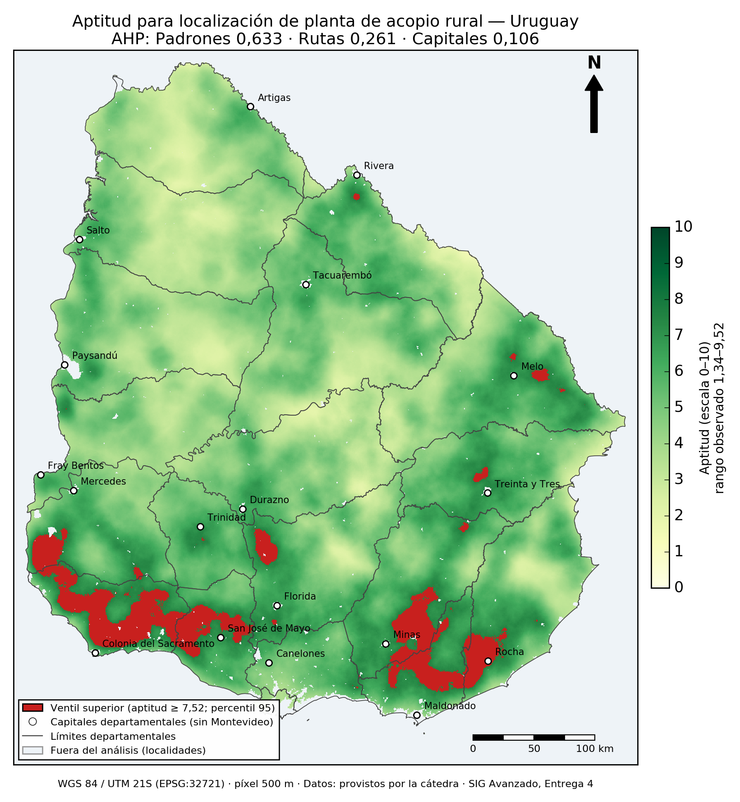
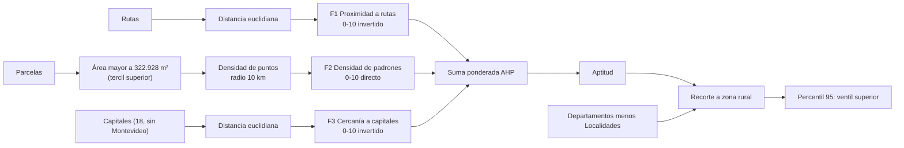

# Localización de una planta de acopio rural en Uruguay: evaluación multicriterio con AHP y SIG

Entrega 4 de SIG Avanzado (2026). El trabajo identifica las zonas del territorio rural uruguayo
con mayor aptitud para instalar una planta de acopio y distribución de insumos agrícolas. Combina
tres factores espaciales con pesos obtenidos mediante el Proceso Analítico Jerárquico (AHP, Saaty)
y se ejecutó en ArcMap 10.8 con Spatial Analyst.



*Aptitud en escala 0–10 y último ventil (percentil 95) resaltado.*

## Resultados principales

| Elemento | Valor |
|---|---|
| Pesos AHP (Padrones · Rutas · Capitales) | 0,633 · 0,261 · 0,106 |
| Razón de consistencia | CR = 0,033 (< 0,10, juicios consistentes) |
| Celdas válidas del análisis | 696.517 (≈ 174.129 km²) |
| Aptitud (mín · máx · media) | 1,34 · 9,52 · 5,07 |
| Umbral del ventil superior (percentil 95) | 7,5204 |
| Ventil superior | 34.827 celdas (5,00 %) ≈ 8.707 km², 189 polígonos |
| Departamentos con más superficie en el ventil | Colonia 34,0 % · Lavalleja 14,8 % · San José 13,6 % · Maldonado 13,3 % |

## Método



- **Sistema de referencia:** WGS 84 / UTM 21S (EPSG:32721), píxel de 500 m, grilla de 983 × 1101,
  todos los ráster alineados al mismo *snap raster* (`dist_rutas`).
- **Aptitud:** `0,633 · F2_padrones + 0,261 · F1_rutas + 0,106 · F3_capitales`.
- **Restricción por recorte, no por máscara.** La distancia euclidiana con máscara activa descarta
  las capitales que quedan fuera de la zona rural (daba una distancia máxima de 491 km). Se calculó
  sin máscara y se recortó después (máximo de 120 km).
- **Parcelas "de mayor superficie":** tercil superior (`AREA_M2 > 322.928`), 84.059 de 252.176
  parcelas (33,3 %). La media (67,5 ha) está inflada por latifundios y deja solo el 21,3 %.
- **Corrección del percentil 95:** el script de la consigna filtra el NoData con `!=` y, por el
  redondeo a float32, cuenta toda la grilla (1.082.283 celdas) y da 7,2421. Con el filtro
  `valores > -1e8` quedan las 696.517 celdas válidas y el percentil 95 es 7,5204. Ver
  [`evidencia_punto6_arcmap.txt`](06_documentos/evidencia_punto6_arcmap.txt).

## Estructura del repositorio

```
02_datos_originales/        Rutas, Departamentos, Localidades, Capitales (Parcelas: ver más abajo)
03_resultados/raster/       Distancias, densidad, factores F1-F3, aptitud_rural y ventil_superior (GeoTIFF)
03_resultados/vectoriales/  zona_rural, ventil_superior_pol, parcelas_grandes_pt
04_mapas/                   Mapa final (PNG)
05_arcmap/                  Script que genera el mapa y verifica las cifras
06_documentos/              Informe en PDF, procedimiento, resolución, informe de proceso y auditoría
```

## Documentos

| Documento | Contenido |
|---|---|
| [`Entrega4_Resultados.pdf`](06_documentos/Entrega4_Resultados.pdf) | Entrega presentada |
| [`Entrega4_procedimiento.md`](06_documentos/Entrega4_procedimiento.md) | Procedimiento paso a paso con parámetros |
| [`Entrega4_resolucion.md`](06_documentos/Entrega4_resolucion.md) | AHP completo, respuestas de discusión y evidencia numérica |
| [`Informe_Entrega4.md`](06_documentos/Informe_Entrega4.md) | Registro de cada proceso: parámetros antes y resultado después |
| [`Entrega4_auditoria.md`](06_documentos/Entrega4_auditoria.md) | Verificación de las cifras contra los archivos de salida |

## Datos

Los datos son públicos y fueron provistos por la cátedra. Los metadatos de los archivos no
registran la fuente institucional original.

| Capa | Geometría | Elementos |
|---|---|---|
| Rutas | Línea | 5.448 |
| Parcelas | Polígono | 252.176 |
| Capitales | Punto | 18 |
| Localidades | Polígono | 652 |
| Departamentos | Polígono | 20 |

`Parcelas` pesa 226 MB y supera el límite de 100 MB por archivo de GitHub, así que no está en el
repositorio. Se publica comprimida (`Parcelas_shapefile.zip`, 147 MB) en la sección
[Releases](../../releases). Para usarla, descomprimir su contenido en `02_datos_originales/`.
El `.gitignore` excluye esos archivos para que no se suban por error.

El enunciado de la entrega no se incluye.

## Cómo reproducir

1. Clonar el repositorio y descargar `Parcelas_shapefile.zip` desde [Releases](../../releases),
   descomprimiéndolo en `02_datos_originales/`.
2. Seguir [`Entrega4_procedimiento.md`](06_documentos/Entrega4_procedimiento.md) en ArcMap 10.8
   con la extensión Spatial Analyst.
3. Para regenerar el mapa y comprobar las cifras (696.517 celdas, percentil 95 = 7,5204, 34.827
   celdas en el ventil), ejecutar [`05_arcmap/mapa_aptitud_ventil.py`](05_arcmap/mapa_aptitud_ventil.py)
   con el Python 2.7 de ArcGIS 10.8 (arcpy y matplotlib 1.5.2). El script toma como raíz la carpeta
   que contiene a `05_arcmap/`. Si se pega en la ventana Python de ArcMap, hay que ejecutarlo con
   el directorio de trabajo en la raíz del repositorio.

Los proyectos `.mxd` no se incluyen porque dependen de rutas locales y de las parcelas.

## Herramientas

ArcMap 10.8 · Spatial Analyst (`EucDistance`, `PointDensity`, Álgebra de mapas) ·
Python 2.7 (arcpy, numpy, matplotlib).
